<h1 align="center">Hybrid RAG</h1>

<p align="center">
  <em>Production hybrid retrieval built from scratch: BM25 and a TF-IDF vector retriever, fused and reranked, with a rigorous retrieval evaluation suite.</em>
</p>

<p align="center">
  <a href="https://github.com/adeoluo/hybrid-rag/actions/workflows/ci.yml"></a>
  
  
  
  
  
</p>

---

## Motivation

Most retrieval-augmented generation tutorials import an embedding model and a vector
database and call it done. This project builds the retrieval stack **from scratch** so the mechanics are visible: BM25's ranking function, a TF-IDF vector retriever fit from the corpus, rank fusion, reranking, and - most importantly -
the **evaluation** that tells you whether any of it works. It has **zero runtime
dependencies** and runs fully offline.

The thesis the project is built around: a retriever is only as good as your ability to
measure it. Every component is scored with standard information-retrieval metrics on a
labeled query set, and the pipelines are compared head to head in an ablation.

## Architecture

<p align="center">
  
</p>

Documents are split by a **chunker**; each chunk is indexed by **BM25** (sparse, lexical)
and a **TF-IDF** vector retriever (sparse, with idf weights fit from the corpus). A query is
run through both; their rankings are merged by **reciprocal rank fusion**; a **reranker**
re-scores the fused candidates; and the whole pipeline is scored by the **evaluation
harness** (recall@k, precision@k, MRR, nDCG). See the [ADRs](docs/adr/) for key choices.

## Components

- **Chunking** - five strategies: `FixedTokenChunker` (overlapping windows),
  `SentenceChunker`, `RecursiveChunker` (separator priority), and `ParagraphChunker`.
- **Retrievers (5)** - Okapi `BM25Retriever`, a `TfidfRetriever`, a
  typo-robust `CharNgramRetriever` (character n-grams), an exact-match `PhraseRetriever`,
  and the fusing `HybridRetriever`.
- **Query processing** - `SynonymExpander` and pseudo-relevance feedback (`expand_with_prf`)
  to improve recall before retrieval runs.
- **Hybrid fusion** - reciprocal rank fusion of any set of retrievers (combines ranks, not
  incomparable scores).
- **Reranking** - a cross-encoder-style `LexicalOverlapReranker`, an `MMRReranker` for
  diversity, and a `RerankedRetriever` that composes retrieve-then-rerank into one retriever.
- **RAG** - `build_context` assembles cited, budget-bounded context with snippet
  highlighting; `ChunkStore` persists a chunked corpus to disk.
- **Evaluation** - recall@k, precision@k, MRR, MAP, DCG/nDCG, success@k, R-precision, an
  aggregating harness, and `compare_retrievers` with a paired-bootstrap significance test.

## Performance

> Measured over a 500-chunk synthetic corpus and 200 queries (`uv run python benchmarks/benchmark.py`).

| Pipeline | Index build (ms) | Queries / sec |
|---|---:|---:|
| `bm25` | 4.5 | 1,696 |
| `tfidf` | 8.7 | 2,241 |
| `hybrid` | 13.2 | 940 |
| `reranked` | 12.9 | 819 |
| `hybrid-all` (4-way fusion) | 47.6 | 330 |
| `mmr` (diversity) | 13.0 | 518 |

All retrieval is pure-Python and in-memory, so hundreds to thousands of queries per second
require no external service.

## Results

> Reproduce with `python -m hybrid_rag ablate`. Metrics averaged over 15 labeled queries.

| Pipeline | recall@3 | precision@3 | MRR | nDCG@3 |
|---|---:|---:|---:|---:|
| `bm25` | 1.000 | 0.611 | 0.967 | 0.975 |
| `tfidf` | 1.000 | 0.611 | 0.967 | 0.975 |
| `hybrid` | 1.000 | 0.611 | 0.967 | 0.975 |
| `reranked` | 1.000 | 0.611 | 0.967 | 0.975 |
| `hybrid-all` | 1.000 | 0.333 | 0.967 | 0.975 |
| `mmr` | 0.933 | 0.589 | 0.933 | 0.933 |

The six pipelines are measured identically on the same labeled queries. The lexical
methods converge on recall here, while the differences surface in precision and MRR: the
4-way `hybrid-all` fusion trades precision for breadth, and `mmr` trades a little recall
for result diversity. The methodological point stands - **a genuine improvement (a better
reranker, real neural embeddings) would show up immediately as a metric gain**, and
`compare_retrievers` reports whether any such difference is statistically significant. See
[limitations](#limitations) for why the lexical methods converge on this corpus.

## Quickstart

```bash
git clone https://github.com/adeoluo/hybrid-rag.git && cd hybrid-rag
make setup                    # install dev tooling + pre-commit hooks
make all                      # lint + type-check + test

# evaluate every pipeline on the bundled labeled queries
python -m hybrid_rag ablate --k 3

# retrieve over the bundled corpus
python -m hybrid_rag query "how do plants make energy from sunlight" --pipeline hybrid
```

Use the library directly:

```python
from hybrid_rag.core import FixedTokenChunker, chunk_documents, Document
from hybrid_rag.retrievers import BM25Retriever, TfidfRetriever, HybridRetriever

chunks = chunk_documents([Document(id="d", text="...")], FixedTokenChunker())
retriever = HybridRetriever([BM25Retriever(), TfidfRetriever()])
retriever.index(chunks)
results = retriever.retrieve("my query", k=5)
```

## Running the service

A dependency-free HTTP service indexes every pipeline once at startup and serves retrieval:

```bash
python -m hybrid_rag serve --port 8000

curl localhost:8000/health
curl -s -X POST localhost:8000/retrieve -d '{"query": "neural networks", "pipeline": "hybrid", "k": 5}'
```

`GET /health` lists the pipelines and chunk count; `POST /retrieve` returns ranked chunks
with scores for a chosen pipeline, so the latency-for-quality tradeoff is selectable per
request. A production-style stress benchmark (`uv run python benchmarks/stress.py`) reports
throughput and p50/p95/p99 latency per pipeline, making that tradeoff concrete; the service
is scaled with processes because the pure-Python handler is bound by the global interpreter
lock. See the [operations guide](docs/OPERATIONS.md), the [scaling and tradeoffs](docs/SCALING.md)
The service also exposes `GET /ready` (readiness) and `GET /metrics` (per-route request, error, and latency metrics in Prometheus text format).
document, and the [case study](docs/CASE_STUDY.md) on choosing a pipeline under a budget.

## Design decisions

- **Reciprocal rank fusion, not score addition.** BM25 and cosine scores are on
  incomparable scales; fusing ranks is robust and parameter-light.
  ([ADR-0002](docs/adr/0002-reciprocal-rank-fusion.md))
- **Fit the TF-IDF weights from the corpus.** The idf weights are computed at index time,
  so the retriever is corpus-specific; it is a sparse lexical method, not a neural dense embedding.
  ([ADR-0003](docs/adr/0003-tfidf-retriever.md))
- **Evaluation is a first-class component**, not an afterthought: the project ships the
  metrics and the harness, and every claim is a reproducible number.

## Responsible AI

- **Model card:** [docs/MODEL_CARD.md](docs/MODEL_CARD.md)
- **Data card:** [docs/DATA_CARD.md](docs/DATA_CARD.md)
- **Threat model:** [docs/THREAT_MODEL.md](docs/THREAT_MODEL.md)

## Limitations

- The TF-IDF retriever is sparse and lexical, sharing vocabulary with BM25; it cannot match
  paraphrases with no lexical overlap. True semantic retrieval needs neural embeddings
  (a deliberate boundary to keep the project dependency-free and from-scratch).
- Because both retrievers are lexical, they converge on the clean bundled corpus; the
  value here is the measurement framework, which would expose differences on a harder or
  semantically-phrased query set.
- The bundled corpus is a demonstration, not a competitive benchmark.

## Roadmap

- [ ] Optional neural embedding retriever behind the same `Retriever` interface
- [ ] Query expansion and pseudo-relevance feedback
- [ ] Persistent on-disk index for larger corpora

## License

[MIT](LICENSE). Part of an artificial intelligence engineering portfolio by
[adeoluo](https://github.com/adeoluo).
