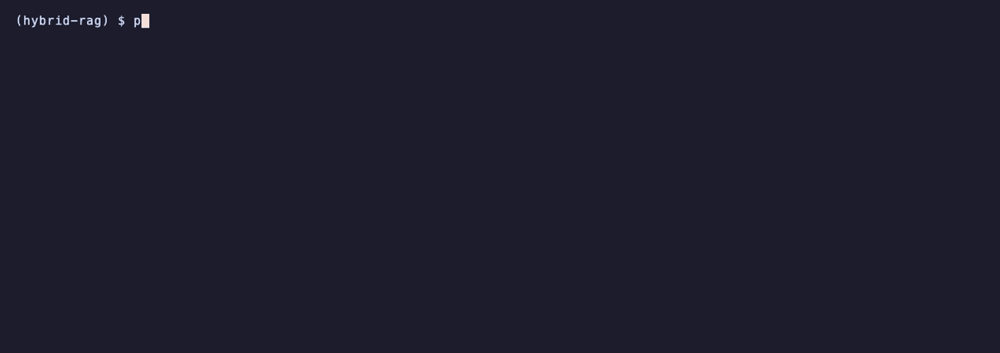
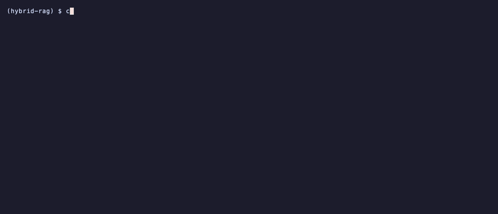

<h1 align="center">Hybrid RAG</h1>

<p align="center">
  <em>The document search step for retrieval-augmented generation (RAG), built from scratch with two keyword search methods and measured on the public BEIR benchmark.</em>
</p>

<p align="center">
  <a href="https://github.com/adeoluo/hybrid-rag/actions/workflows/ci.yml"></a>
  <a href="https://github.com/adeoluo/hybrid-rag/releases"></a>
  
  <a href="LICENSE"></a>
</p>

---

> **Evidence level: publicly benchmarked.** The project is tested on two public BEIR datasets, SciFact and TREC-COVID, against the published BM25 baseline and the rank_bm25 library. No one else has reproduced the results, and the code is not used in production. [What the levels mean](https://github.com/adeoluo#evidence-levels).

## Highlights

Before an AI model answers questions from a set of documents, a search step must find the
right documents. This project builds that search step from scratch and, most importantly,
measures how well it works.

- **Its keyword search scores higher than the published baseline on SciFact.** On SciFact, a
  standard test set of science abstracts, it scores 0.687 nDCG@10 compared with 0.665 for the
  published BM25 baseline. nDCG@10 runs from 0 to 1, and higher is better.
- **Its keyword search is about 70 times faster than rank_bm25, a common Python library.** On
  SciFact it takes 0.18 ms per question compared with 13.19 ms, and it also scores higher.
- **It reports a result that tutorials skip: mixing two search methods did not help here.**
  On SciFact, the "hybrid" search, which merges the rankings of two methods, scored 0.665
  compared with 0.687 for plain keyword search.

**Where it falls short:** none of the benchmarked search methods uses neural embeddings
(number vectors, learned by a neural network, that capture word meaning). Both methods in the
hybrid search match words, so "hybrid" here means two word-based methods combined.

## Key terms

Plain definitions of the terms used in this README.

| Term | Meaning |
|---|---|
| Ablation | A comparison that runs several versions of a system, each with one part added or removed, to show what each part contributes. |
| BEIR | Benchmarking Information Retrieval: a standard collection of public search test sets with known correct answers, so results can be compared with published ones. |
| BM25 | Best Matching 25 (Okapi BM25): a classic keyword ranking formula. It scores a document higher when it contains the query words often, and when those words are rare elsewhere. |
| Character n-grams | Short runs of letters (for example "pho", "hot", "oto"). Matching on them still finds a word when it is misspelled. |
| Chunk | A short passage cut from a document. The search indexes and returns chunks, not whole documents. |
| Cross-encoder | A reranking model that reads the query and one candidate together and scores the pair. Neural cross-encoders are not part of this project. |
| Hybrid retrieval | Search that runs several retrievers and merges their ranked lists into one list. |
| Inverted index | A lookup table from each word to the chunks that contain it (its postings), so a query only touches chunks that share a word with it. |
| Lexical retrieval | Search that matches the exact words (or word stems) of the query. It cannot match a text that says the same thing in other words. |
| MMR | Maximal marginal relevance: a reranking method that balances relevance to the query against variety, so the top results are not near-duplicates. |
| MRR | Mean reciprocal rank: the average of 1 divided by the position of the first correct result. It runs from 0 to 1, and higher is better. |
| nDCG@10 | Normalized discounted cumulative gain over the top 10 results. It gives more credit to more relevant documents placed nearer the top. From 0 to 1, higher is better. |
| Neural embedding | A list of numbers, learned by a neural network, that represents the meaning of a word or text. A dense retriever ranks by comparing these vectors. |
| Paired bootstrap | A statistical test that resamples the same queries many times to judge whether the score difference between two pipelines is real or due to chance. |
| Porter stemming | A rule-based method (Porter, 1980) that cuts words to a shared stem, so "treatments" and "treated" both become "treat". |
| Precision at k | The share of the top k results that are relevant. It runs from 0 to 1, and higher is better. |
| RAG | Retrieval-augmented generation: an AI model first retrieves relevant documents, then writes its answer from them. |
| rank_bm25 | A common Python library that implements BM25. Here it is an independent comparison point, run on the same words. |
| Recall at k | The share of all relevant documents found in the top k results. From 0 to 1, higher is better. BEIR's capped recall@100 divides by at most 100 relevant documents. |
| Reciprocal rank fusion (RRF) | A way to merge ranked lists: each document gets points based on its position in each list. It uses positions, not raw scores. |
| Reranking | A second step that reorders a short list of candidates from the first search, using a slower or different scoring method. |
| SciFact | A BEIR test set of 5,183 scientific abstracts and 300 queries. |
| TF-IDF | Term frequency-inverse document frequency: a word weighting that counts how often a word appears in a text, and gives rare words more weight. |
| TREC-COVID | A BEIR test set of 171,331 COVID-19 research papers and 50 queries, with many documents judged for each query. |
| Zero-shot | Tested on data the system was not trained or tuned on. |

## Motivation

Most tutorials on retrieval-augmented generation import an embedding model and a vector
database (a database that finds similar number vectors), and stop there. This project
builds the search part **from scratch** so that each step is visible. The steps are the BM25
ranking function, a TF-IDF retriever fitted to the documents, rank fusion and reranking. Most
important is the **evaluation**, which shows whether any of it works. The library and its
bundled sample data run fully offline. The BEIR benchmark needs a one-time dataset download.

The central idea of the project is that a retriever is only as good as the ability to measure
it. Every retrieval pipeline is scored with standard information-retrieval metrics on a set of
queries with known correct answers. The pipelines are then compared side by side in an
ablation.

## Architecture

<p align="center">
  
</p>

<sub>Legend: amber = entry points and external systems, indigo = core logic, green = data and state, blue = validation and control, grey = observability and outputs.</sub>

A **chunker** splits the documents into chunks, and each named pipeline indexes them once.
The sparse retrievers, which score only the words a query and a chunk share, are **BM25**,
**TF-IDF**, character n-grams and exact phrase matching. A **neural dense retriever**, also
written from scratch, uses skip-gram word embeddings (word vectors learned by predicting nearby
words). It ranks chunks by cosine similarity, which measures how closely two vectors point the
same way.
A query comes from the command-line interface (CLI) or from a checked `/retrieve` web
request, and runs through the chosen pipeline. A pipeline is either one retriever, or several
retrievers whose rankings are merged by **reciprocal rank fusion**. A **reranker** can then
reorder the results, by word overlap or by MMR. The **evaluation harness** scores every
pipeline on queries with known answers, using recall@k, precision@k, MRR and nDCG. A paired
bootstrap compares two pipelines. The web service records requests, errors and latency
(response time) per route for `/metrics`, except for the `/ready` and `/metrics` routes
themselves. See the [ADRs](docs/adr/) (architecture decision records) for key choices.

### Components

- **Chunking**: four strategies. `FixedTokenChunker` cuts fixed-size word windows that
  overlap. `SentenceChunker` packs whole sentences up to a word limit. `RecursiveChunker`
  splits on a priority list of separators. `ParagraphChunker` makes one chunk per paragraph.
- **Retrievers (5)**: Okapi `BM25Retriever`, a `TfidfRetriever`, a `CharNgramRetriever`, an
  exact-match `PhraseRetriever`, and the `HybridRetriever`, which fuses other retrievers. The
  `CharNgramRetriever` matches character n-grams, so it can still find a word that is misspelled.
- **Query processing**: `SynonymExpander` adds known synonyms to a query. `expand_with_prf`
  uses pseudo-relevance feedback: it runs a first search and adds key words from the top
  results to the query. Both aim to raise recall before the main search runs.
- **Hybrid fusion**: reciprocal rank fusion of any set of retrievers. It combines rank
  positions, not raw scores, because scores from different retrievers cannot be compared.
- **Reranking**: `LexicalOverlapReranker` scores each query and chunk pair together, in the
  style of a cross-encoder, by their word overlap. `MMRReranker` adds variety to the results.
  `RerankedRetriever` joins a retriever and a reranker into one retriever.
- **RAG**: `build_context` builds a numbered context block with source citations, within a
  character budget, using the most relevant snippet of each chunk. `ChunkStore` saves a
  chunked document collection to disk and loads it again.
- **Evaluation**: the metrics are recall@k, precision@k, MRR, mean average precision (MAP),
  discounted cumulative gain (DCG), nDCG, success@k and R-precision. Success@k is 1 when any
  relevant result is in the top k. R-precision is precision at a cutoff equal to the number of
  relevant documents. A harness averages the metrics over queries, and `compare_retrievers`
  runs a paired-bootstrap significance test.

## Results

### Zero-shot retrieval on BEIR (SciFact and TREC-COVID)

> Reproduce: download a BEIR dataset (for example
> `https://public.ukp.informatik.tu-darmstadt.de/thakur/BEIR/datasets/scifact.zip`), unzip it, and run
> `uv run --with rank_bm25 python benchmarks/beir.py --data scifact --rank-bm25`.
> The metrics follow BEIR: nDCG@10 with graded gains (more credit for more relevant documents) and capped recall@100. The runs used an Apple M1 on one thread. Raw numbers: `benchmarks/results/`.

[BEIR](https://github.com/beir-cellar/beir) is the standard zero-shot retrieval benchmark, so these
numbers can be compared with published ones. The published BEIR BM25 baseline, which uses
Elasticsearch (a widely used search server), scores **0.665** nDCG@10 on SciFact and **0.656** on
TREC-COVID. `rank_bm25` (its BM25Okapi class) runs on the same tokens (the same processed words)
as an independent second BM25 implementation.

**SciFact**: 5,183 scientific abstracts, 300 queries.

Each row below is one retriever or pipeline of this project, plus `rank_bm25` for comparison.
nDCG@10 and Recall@100 measure quality, and higher is better. Index build (time to build the
index once) and Query (average time per query) measure speed, and lower is better.

| Retriever | nDCG@10 | Recall@100 | Index build | Query |
|---|---:|---:|---:|---:|
| **bm25** | **0.687** | **0.928** | 0.56 s | **0.18 ms** |
| tfidf | 0.606 | 0.926 | 0.56 s | 0.18 ms |
| hybrid | 0.665 | 0.926 | 0.97 s | 0.88 ms |
| reranked | 0.596 | 0.865 | 1.21 s | 1.60 ms |
| hybrid-all | 0.615 | 0.927 | 5.92 s | 2.99 ms |
| mmr | 0.657 | 0.865 | 0.95 s | 10.38 ms |
| rank_bm25 BM25Okapi | 0.665 | 0.886 | 0.45 s | 13.19 ms |

**TREC-COVID**: 171,331 CORD-19 papers (from the COVID-19 Open Research Dataset), 50 queries
with deep judgments (many documents judged for each query). Peak memory for the whole run,
including the documents, all three indexes and rank_bm25, is 1.75 GB.

This table has the same columns as the SciFact table, for the four retrievers run on this
larger dataset. Higher is better for nDCG@10 and Recall@100, and lower is better for the times.

| Retriever | nDCG@10 | Recall@100 | Index build | Query |
|---|---:|---:|---:|---:|
| **bm25** | **0.663** | **0.528** | 20.9 s | **2.5 ms** |
| tfidf | 0.472 | 0.424 | 18.6 s | 2.1 ms |
| hybrid | **0.666** | 0.522 | 34.0 s | 5.1 ms |
| rank_bm25 BM25Okapi | 0.578 | 0.471 | 10.0 s | 514.2 ms |

The machine had other applications running, so the absolute times are noisy. Rows in one
table come from the same run, so they compare fairly.

What changed, and what each change gained:

- **Porter stemming**, written from scratch in `core/stemming.py`. It gives the same stems as
  the original-algorithm Porter stemmer in NLTK (a Python natural-language toolkit) on all
  34,955 SciFact words longer than two letters. On SciFact it lifts BM25 from 0.669 to
  **0.687** nDCG@10, and recall@100 from 0.886 to 0.928. BM25 now **beats the published BEIR
  baseline on SciFact (0.687 compared with 0.665) and matches it on TREC-COVID (0.663 compared
  with 0.656)**. On the same tokens, it also beats `rank_bm25` by 0.022 on SciFact and by 0.085
  on TREC-COVID.
- **Inverted indexes in flat arrays** for BM25, TF-IDF, character n-grams and phrases. Each
  word's postings are slices of two numpy (Python's numerical array library) arrays: chunk ids
  and precomputed weights. A query adds the weights of its words into one score array, so only
  chunks that share a word with the query are touched. With stemming off, the indexes return
  exactly the rankings of the old full scans, which scored every chunk. This was checked on
  every SciFact query, and the BM25, character n-gram and phrase scores are bit for bit equal.
  Queries became **44 times faster for BM25 on SciFact** (from 7.98 ms to 0.18 ms), 19 times
  faster for `hybrid` and 27 times faster for `hybrid-all`. BM25 answers **about 200 times
  faster than `rank_bm25` on TREC-COVID**. The hybrid pipeline on TREC-COVID went from 731 ms
  to 5.1 ms per query. The old design stored each posting as a Python tuple, which pushed the
  171,000-document indexes into swap (slow disk-backed memory) on this 8 GB machine.

Where it does not win:

- **Fusion does not help on these datasets.** The `hybrid` pipeline scores slightly lower than
  BM25 alone on SciFact (0.665) and only ties it on TREC-COVID (0.666). The reason is that its
  second retriever, TF-IDF, is a weaker word-matching signal, not a different kind of signal.
  The word-overlap reranker and MMR lower nDCG. For fusion to pay off, it needs a neural dense
  retriever trained on far more data.
- **Index build is slower than `rank_bm25`** (20.9 s compared with 10.0 s on TREC-COVID). This
  is mostly because every word is stemmed and every posting is written out, and the build runs
  in Python.
- **Every benchmark result is lexical.** Learned dense retrievers and cross-encoders trained on
  large data score higher on both datasets on the BEIR leaderboard. This library does not
  include one. Its small from-scratch dense retriever is not part of these benchmarks.

### Offline CLI smoke fixture (`python -m hybrid_rag ablate`)

The bundled offline command (`python -m hybrid_rag ablate`) runs all eight pipelines,
including a from-scratch skip-gram `dense` retriever. It runs them on a tiny smoke fixture, a
quick check that everything runs. The fixture is stored in the package and has 13 short
documents and 15 queries with known answers. So `make evaluation` runs without downloading BEIR. All eight pipelines
find every relevant document in the top 5 results (`recall@5 = 1.000`). The mean reciprocal
rank is `MRR = 0.933` for the other seven pipelines and `0.913` for `mmr`. Because 13 short
passages are easy to match on exact words, every pipeline scores near the top here. For this
reason, all quality and speed comparisons on real data use the BEIR datasets above.

### Scale

`benchmarks/scale.py` runs the main `hybrid` pipeline (BM25 and TF-IDF fusion) over larger and
larger synthetic (generated) chunk collections, with a fixed set of 80 queries. Each query has
one planted relevant chunk. The script reports wall-clock time, queries per second, peak memory
and recall@5. Peak memory is measured with `tracemalloc` (Python's built-in memory tracer) in a
separate pass, so the tracer does not slow down the timed run. Measured on this machine
(`uv run python benchmarks/scale.py`):

Each row is one collection size. Seconds (time to index and run all 80 queries) and Peak MiB
(peak memory in mebibytes) are better when lower. Queries/sec and recall@5 are better when
higher.

| Chunks | Seconds | Queries/sec | Peak MiB | recall@5 |
|---:|---:|---:|---:|---:|
| 500 | 0.025 | 8,431 | 0.8 | 0.53 |
| 1,000 | 0.046 | 6,308 | 1.6 | 0.38 |
| 2,000 | 0.076 | 6,168 | 3.1 | 0.31 |
| 4,000 | 0.139 | 4,209 | 6.2 | 0.21 |

Before the inverted indexes, the same runs took 1.35 to 10.07 seconds, at 67 to 9 queries per
second, with 2.3 to 18.3 MiB peak memory. Throughput now falls slowly as the collection grows,
because a query only touches chunks that share a word with it. Recall falls as the number of
random distractor chunks grows. These are synthetic data. The BEIR section above is the
real-data measurement.

### Performance

> Measured on a 500-chunk synthetic corpus with 200 queries (`uv run python benchmarks/benchmark.py`).

Each row is one pipeline. Index build (ms) is the time to build its index once, where lower is
better. Queries / sec is the number of queries answered per second, where higher is better.

| Pipeline | Index build (ms) | Queries / sec |
|---|---:|---:|
| `bm25` | 8.4 | 23,443 |
| `tfidf` | 8.7 | 24,301 |
| `hybrid` | 15.4 | 7,608 |
| `reranked` | 14.9 | 2,906 |
| `hybrid-all` (4-way fusion) | 80.0 | 2,652 |
| `mmr` (diversity) | 14.7 | 951 |

All retrieval runs inside one process and in memory. Compared with the previous full scans,
query throughput is 8 to 14 times higher (BM25 went from 1,696 to 23,443 queries per second).
Index build is a few milliseconds slower, because postings and stems are computed up front.

## Quickstart

```bash
git clone https://github.com/adeoluo/hybrid-rag.git && cd hybrid-rag
make setup                    # install dev tooling + pre-commit hooks
make all                      # lint + type-check + test

# evaluate every pipeline on the bundled labeled queries
python -m hybrid_rag ablate --k 3

# retrieve over the bundled corpus
python -m hybrid_rag query "how do plants make energy from sunlight" --pipeline hybrid
```

Use the library directly:

```python
from hybrid_rag.core import FixedTokenChunker, chunk_documents, Document
from hybrid_rag.retrievers import BM25Retriever, TfidfRetriever, HybridRetriever

chunks = chunk_documents([Document(id="d", text="...")], FixedTokenChunker())
retriever = HybridRetriever([BM25Retriever(), TfidfRetriever()])
retriever.index(chunks)
results = retriever.retrieve("my query", k=5)
```

## Usage

The recording below is a real run: a hybrid query with its fused scores, then the retrieval ablation across all eight pipelines. To record it again, run `vhs docs/demo/query.tape` (vhs is a terminal recording tool).

<p align="center">
  
</p>

### HTTP service

A web (HTTP) service, built only on Python's standard library, indexes every pipeline once at startup and then answers retrieval requests:

```bash
python -m hybrid_rag serve --port 8000

curl localhost:8000/health
curl -s -X POST localhost:8000/retrieve -d '{"query": "neural networks", "pipeline": "hybrid", "k": 5}'
```

`GET /health` lists the pipelines and the number of chunks. `POST /retrieve` returns ranked
chunks with scores from the chosen pipeline, so each request can choose its own balance between
speed and quality. A production-style stress benchmark (`uv run python benchmarks/stress.py`)
sends sustained, concurrent load. It reports throughput and p50, p95 and p99 latency per
pipeline, which makes that balance concrete. These are the response times that 50, 95 and 99
percent of requests stay under. The request handler is CPU-bound Python and is limited by the global
interpreter lock (which lets only one thread run Python code at a time). So the service scales
by running more processes, not more threads. The service also exposes `GET /ready` (a readiness
check) and `GET /metrics`. The metrics route gives request, error and latency counts per route
in the text format of Prometheus, a monitoring system. See the [operations guide](docs/OPERATIONS.md), the
[scaling and tradeoffs](docs/SCALING.md) document, and the [case study](docs/CASE_STUDY.md) on choosing a pipeline under a budget.

### Demos

These recordings come from real runs made with [vhs](https://github.com/charmbracelet/vhs). Each recording script (tape) is in `docs/demo/`.

The same query through three retrieval pipelines.

<p align="center">
  
</p>

The HTTP service answering a request with the hybrid pipeline.

<p align="center">
  
</p>

## Design decisions

- **Reciprocal rank fusion, not score addition.** BM25 scores and cosine scores are on
  different scales that cannot be compared. Fusing rank positions is robust and needs few
  settings.
  ([ADR-0002](docs/adr/0002-reciprocal-rank-fusion.md))
- **Fit the TF-IDF weights from the corpus.** The inverse document frequency (idf) weights,
  which make rare words count more, are computed when the index is built. So the retriever is
  specific to its document collection. It is a sparse word-matching method, not a neural dense
  embedding.
  ([ADR-0003](docs/adr/0003-tfidf-retriever.md))
- **Inverted indexes in flat arrays, with exact parity.** Each retriever stores its postings in
  two numpy arrays, grouped by word, and a query adds precomputed weights into a score array.
  The scoring formulas are unchanged and the additions happen in the same order, so the
  rankings are the ones a full scan gives. ([ADR-0004](docs/adr/0004-inverted-index-and-stemming.md))
- **Porter stemming on by default for BM25 and TF-IDF**, because it raised BM25's nDCG@10 on
  BEIR SciFact from 0.669 to 0.687. Setting `stem=False` restores exact-word matching.
- **Evaluation is a core component**, not an afterthought. The project ships the metrics and
  the harness, and each results table names the command that reproduces it.

## Testing

```bash
make test                    # uv run pytest
uv run pytest -m "not slow"   # the CI selection, without full-pipeline training runs
make lint type               # ruff format check, ruff lint, mypy
```

The tests in `tests/` cover:

- tokenization and every chunker (`test_core.py`, `test_query_chunking.py`)
- each retriever, including BM25, TF-IDF, character n-gram, phrase, and the from-scratch neural dense retriever (`test_retrievers.py`, `test_more_retrievers.py`, `test_dense.py`)
- reciprocal rank fusion, reranking, and MMR (`test_fusion_rerank.py`)
- the retrieval metrics and evaluation harness (`test_evaluation.py`)
- paired-bootstrap retriever comparison (`test_comparison.py`)
- RAG context assembly and chunk persistence (`test_rag_persistence.py`)
- the command-line interface (`test_cli.py`)
- the HTTP handler layer (`test_service.py`)

Tests marked `slow` train every pipeline end to end, including the neural dense retriever. They are left out of continuous integration (CI, the automatic checks on every change), and the CLI and benchmarks reproduce them. CI runs ruff format and ruff lint (a Python code formatter and checker), mypy (a type checker) and `pytest -m "not slow"` (the test runner). It requires at least 80% test coverage and runs on Python 3.12, 3.13, 3.14 and 3.15. It then builds the package and the Docker image.

## Responsible AI

- **Model card:** [docs/MODEL_CARD.md](docs/MODEL_CARD.md)
- **Data card:** [docs/DATA_CARD.md](docs/DATA_CARD.md)
- **Threat model:** [docs/THREAT_MODEL.md](docs/THREAT_MODEL.md)

## Limitations

- The TF-IDF retriever is sparse and lexical, and it shares its vocabulary with BM25. It
  cannot match paraphrases (texts that say the same thing with no words in common). Real
  semantic retrieval, which matches by meaning, needs neural embeddings. This is a deliberate
  boundary, to keep every retriever written from scratch and easy to inspect.
- Because both retrievers are lexical, they reach the same results on the clean bundled
  corpus. The value here is the measurement framework, which would show differences on a
  harder query set, or on one phrased by meaning rather than by keyword.
- The bundled corpus is a demonstration, not a competitive benchmark. The BEIR results are the
  real-data measurement.
- Indexing runs in Python, so building an index over 171,000 documents takes about 20 seconds
  per retriever. This is twice the time `rank_bm25` needs, and every index is held in memory.

## Roadmap

- [ ] Optional neural embedding retriever behind the same `Retriever` interface
- [ ] Query expansion and pseudo-relevance feedback
- [ ] Persistent on-disk index for larger corpora

## License

Released under the [MIT License](LICENSE).
